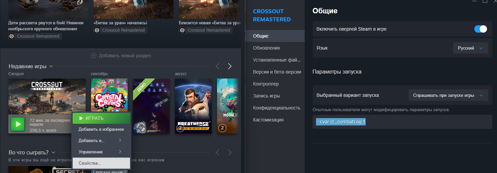
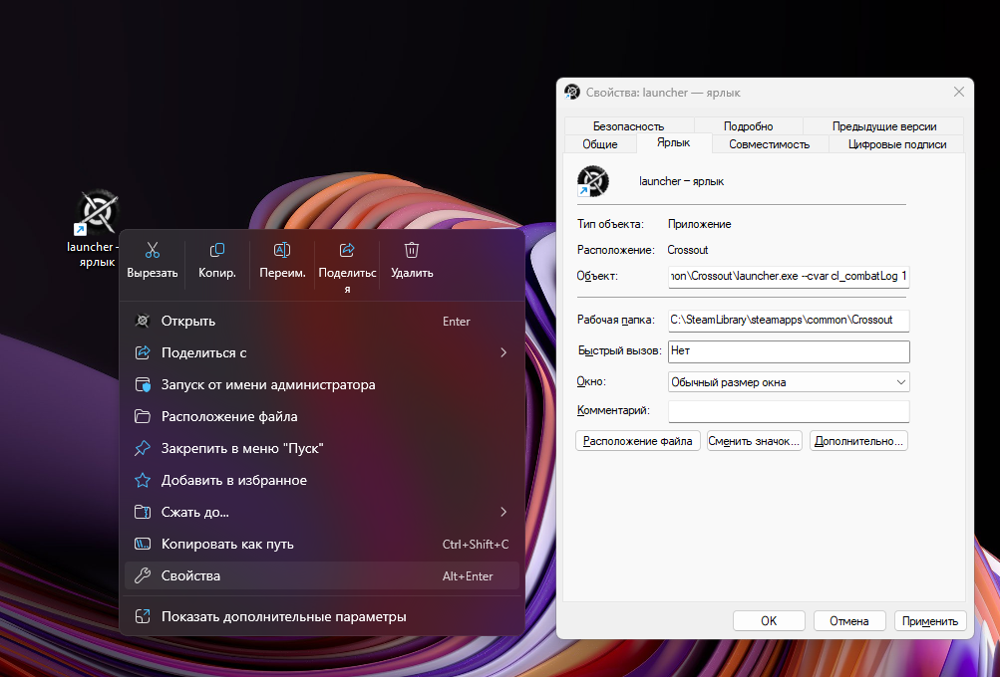
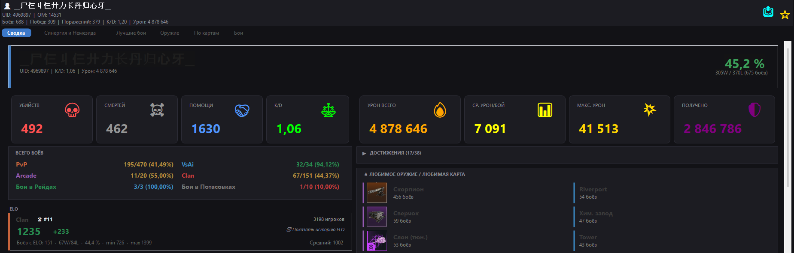
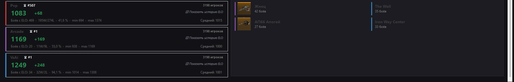
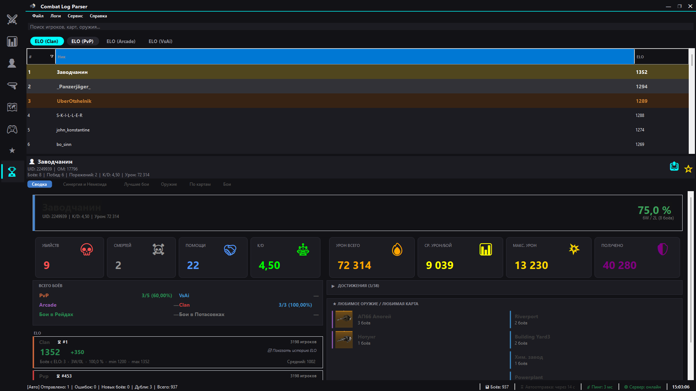
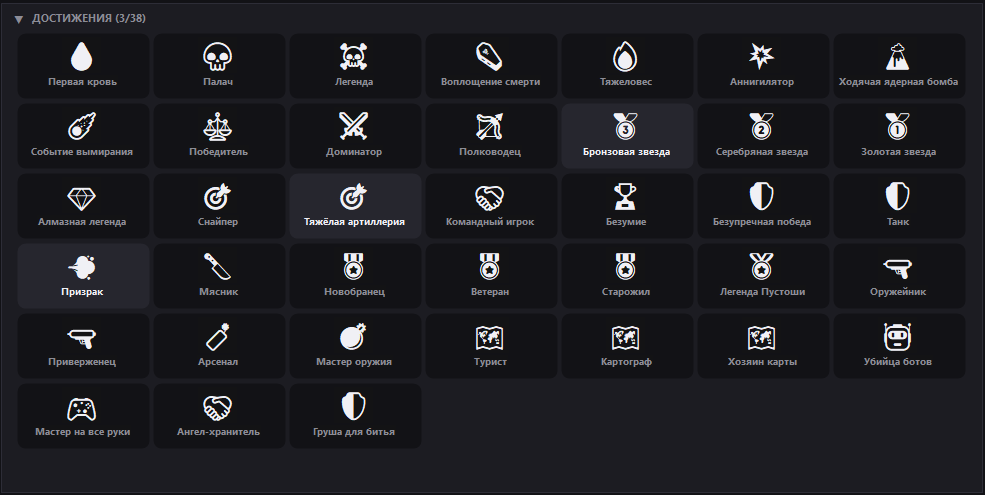
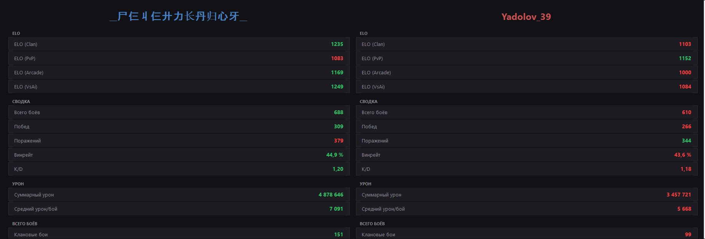
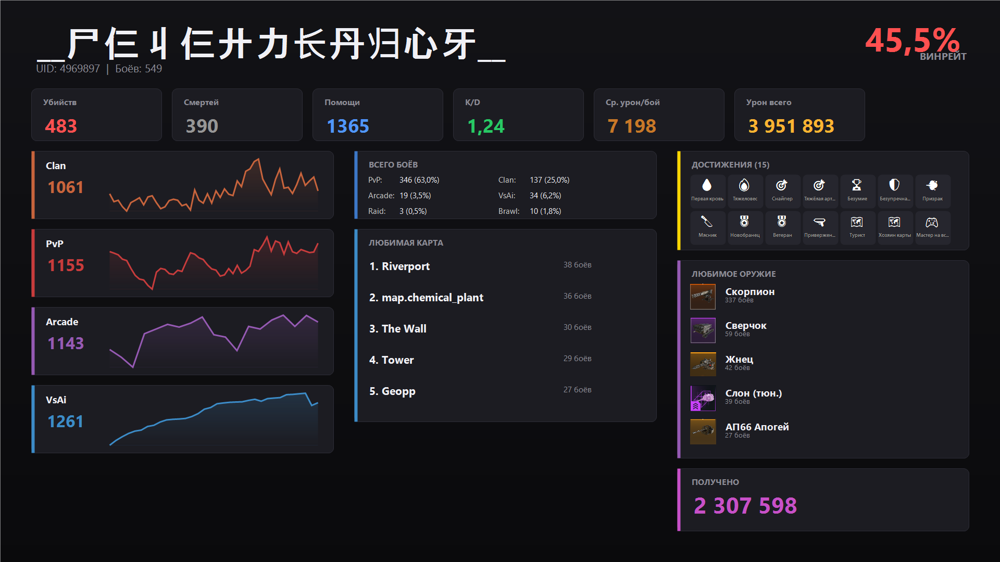
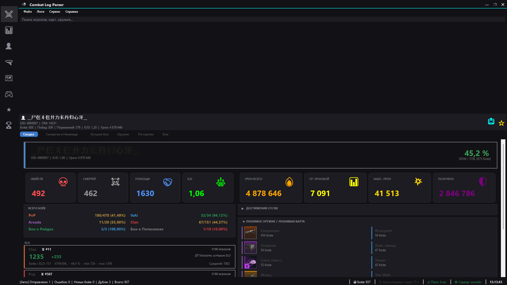
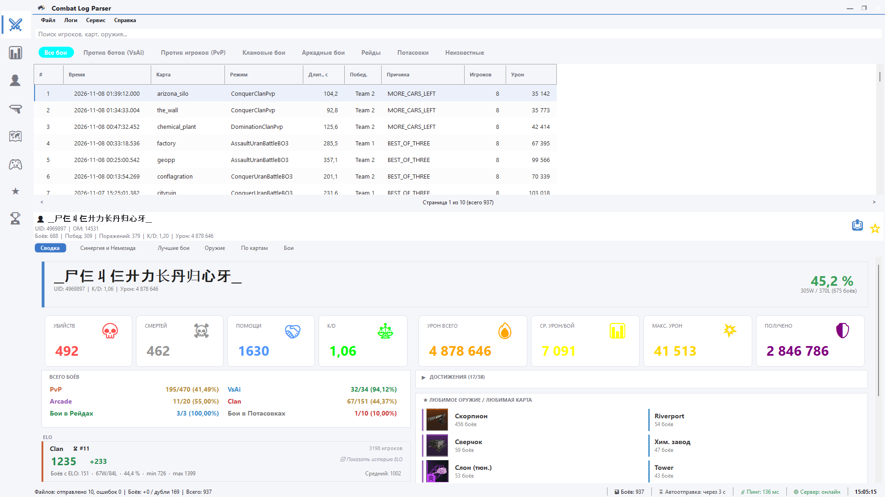

# Combat Log Parser (Client)

**Combat Log Parser** — это программа для автоматического сбора и анализа статистики из игры **Crossout**. 

Клиент подключается к нашему серверу, автоматически отправляет логи боёв, парсит их и отображает в удобном интерфейсе: рейтинги ELO, статистика по игрокам, оружию, картам и режимам.

> ⚠️ **Внимание:** В этом репозитории находится **только собранный клиент** (бинарные файлы). Исходный код серверной части и клиента не публикуется.

---

## 📥 Установка

1. Перейдите в раздел **[Releases](../../releases)**.
2. Скачайте последнюю версию `CombatLogParser.zip`.
3. Распакуйте архив в любую папку (например, `C:\Games\CombatLogParser`).
4. Убедитесь, что рядом с `CombatLogParser.exe` лежит папка `images` (иконки оружия) и `weapons.txt`.
5. Запустите `CombatLogParser.exe`.

*(Для работы требуется .NET Framework 4.8 — он уже встроен в Windows 10/11).*

---

## 🛠️ Настройка создания логов

Программа не сможет отправлять логи если их нет. Поэтому перед тем как с ней работать необходимо настроить создание логов.

ПЕРВЫЙ СПОСОБ (Через Steam)
    
    1. ПКМ по игре Crossout
    2. ПКМ по кнопке "Свойства"
    3. В разделе Параметры запуска в поле написать следующую строку *--cvar cl_combatLog 1*

ВТОРОЙ СПОСОБ (Через ярлык)
    
    1. ПКМ по ярлыку игры Crossout. Далее свойства
    2. В поле "объект" добавьте ключ *--cvar cl_combatLog 1*
    3. Нажать "Применить"

---

## 🚀 Первый запуск

0. Скачайте RadminVPN (Для подключения к серверу) и подключитесь к существующей сети
   * Название: *CombatLogParser*
   * Пароль: *CrossoutItIsBestGame*
2. При запуске программа попросит указать **папку с логами** игры. 
   * Обычно это: `%LOCALAPPDATA%\Targem\Crossout\logs` (можно вставить этот путь в адресную строку Проводника, чтобы проверить).
3. Введите ваш **никнейм** или **UID** для входа в личный кабинет (профиль игрока).
4. Перейдите в настройки программы через Сервис -> Настройки
5. Откройте раздел "Данные" и в поле URL сервера укажите следующий адрес http://26.77.82.150:5000/
6. Программа автоматически отправит все накопленные логи на сервер и загрузит статистику.

После этого клиент будет в фоне проверять папку с логами и автоматически отправлять новые бои на сервер (интервал настраивается).

---

## 🛠️ Возможности

*   **Автоотправка логов**: не нужно ничего нажимать, программа сама находит `combat.log` и отправляет его.
*   **Личный кабинет**: при запуске сразу открывается ваш профиль.
*   **Статистика ELO**: рейтинги по режимам (PvP, Clan, Arcade, VsAi) с интерактивными графиками.
*   **Топ игроков (Leaderboard)**: таблица лучших 50 игроков по каждому ELO-режиму с подсветкой топ-3.
*   **Достижения**: 34 бейджа за различные игровые успехи (убийства, урон, винрейт, победы без смертей и др.).
*   **Сравнение игроков**: возможность открыть два профиля бок о бок и сравнить их статистику.
*   **Глобальный поиск**: мгновенный поиск по игрокам, картам, оружию, боям и сессиям.
*   **Избранное**: добавляйте игроков и карты в избранное для быстрого доступа.
*   **Карточка для шаринга**: генерация красивой Full HD картинки (1920x1080) с вашей статистикой и графиками.
*   **Анализ оружия**: какое оружие вы используете чаще всего и насколько оно эффективно.
*   **Боевой рейтинг**: оценка вашего вклада в каждом бою (от 0 до 100).
*   **Тёмная тема**: неоновая подсветка для комфортной игры ночью.
*   **Автообновление**: клиент сам скачает новую версию с сервера при запуске.

---

## 🖼️ Скриншоты

### 1. Профиль игрока (Сводка и Графики)
<!-- ВСТАВЬТЕ ССЫЛКУ НА КАРТИНКУ: profile_summary.png -->

### 2. Топ игроков (Leaderboard)
<!-- ВСТАВЬТЕ ССЫЛКУ НА КАРТИНКУ: leaderboard.png -->

### 3. Достижения (Achievements)
<!-- ВСТАВЬТЕ ССЫЛКУ НА КАРТИНКУ: achievements.png -->

### 4. Сравнение игроков (Player Comparison)
<!-- ВСТАВЬТЕ ССЫЛКУ НА КАРТИНКУ: comparison.png -->

### 5. Карточка игрока для шаринга (Full HD)
<!-- ВСТАВЬТЕ ССЫЛКУ НА КАРТИНКУ: share_card.png -->

### 6. Тёмная тема
<!-- ВСТАВЬТЕ ССЫЛКУ НА КАРТИНКУ: dark_theme.png -->

### 7. Светлая тема
<!-- ВСТАВЬТЕ ССЫЛКУ НА КАРТИНКУ: dark_theme.png -->

---

## ⚙️ Настройки

Настройки хранятся в `%APPDATA%\CombatLogParser\settings.json` и доступны через меню **Сервис -> Настройки**.

*   **Язык**: Русский / Английский.
*   **Тема**: Светлая / Тёмная.
*   **Сервер**: URL сервера (по умолчанию `http://localhost:5000`).
*   **Автоотправка**: включить/выключить и указать интервал.

---

## ❓ Частые вопросы (FAQ)

**Q: Где взять папку с логами?**  
A: Обычно она находится здесь: `C:\Users\<Имя>\AppData\Local\Targem\Crossout\logs`. Если папки нет — запустите игру и сыграйте один бой.

**Q: Программа пишет «Сервер офлайн». Что делать?**  
A: Проверьте интернет-соединение. Если сервер недоступен, клиент будет пытаться переподключиться каждые 5 секунд.

**Q: Почему не отображаются картинки оружия?**  
A: Убедитесь, что папка `images` находится в той же директории, что и `CombatLogParser.exe`.

**Q: Как сменить игрока?**  
A: Меню **Сервис -> Сменить игрока...** (или перезапустите клиент и введите другой ник).

**Q: Что такое «Боевой рейтинг»?**  
A: Это оценка от 0 до 100, которая показывает, насколько хорошо вы сыграли в конкретном бою (зависит от убийств, урона и смертей). В отличие от ELO, он не накапливается, а показывает «чистый» вклад.

---

## 📄 Лицензия

Программа распространяется «как есть» (AS IS). Автор не несёт ответственности за возможные сбои в работе игры. 
Исходный код является закрытым.
